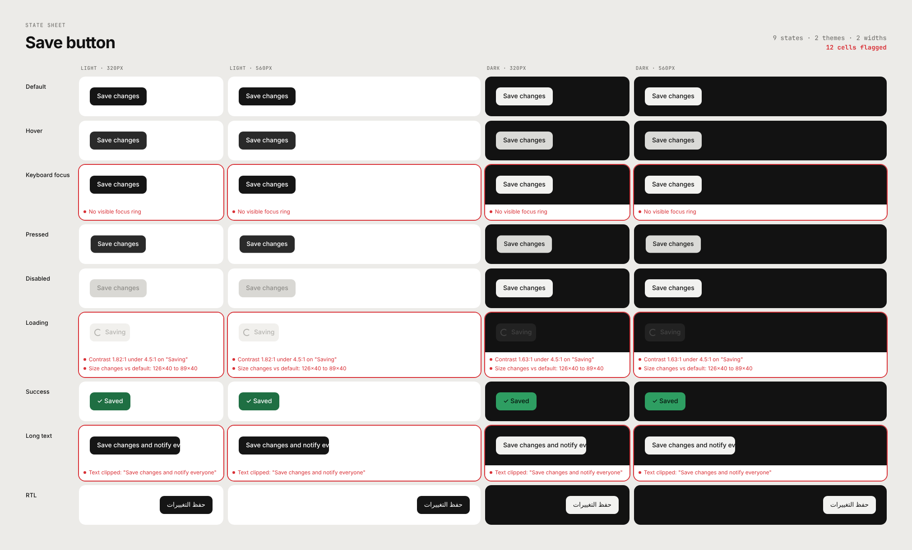

# state-sheet-skill



**A Claude skill that renders every state of a component on one review sheet: empty, loading, error, long text, huge numbers, RTL, dark mode and keyboard focus. Then it flags what breaks.**

Designers used to lay out every state side by side and spot the broken one at a glance. In code you see one happy state at a time, and the rest turn up in production. This puts the whole picture back on one sheet.

## What you get

- **One image** with every state in light and dark, at a narrow and a wide width.
- **Red flags on the cells that break**, with a plain reason on each:

| Flag | Meaning |
| --- | --- |
| Text clipped | Content is cut off with no ellipsis, sideways or at the bottom |
| Number cut off | An amount, ID or count is truncated |
| Spills out | Text runs past the component's edge |
| Contrast | Text under WCAG AA |
| No visible focus ring | Tab reaches the control but nothing changes |
| Target too small | A button is under 24 x 24 px, too small to tap (WCAG 2.2) |
| Size changes | A state jumps in size, like a button that shrinks while loading |
| Renders nothing | A missing state |

- **A report** (`report.md` and `report.json`) for a PR or CI.

Claude also looks at the sheet for what can't be measured, like a disabled button that looks enabled in dark mode, and fixes problems one by one, re-rendering the sheet until every cell is clean.

## Install

**Claude Code**

```bash
git clone https://github.com/eb-ekeledo/state-sheet-skill ~/.claude/skills/state-sheet
cd ~/.claude/skills/state-sheet && npm install && npx playwright install chromium
```

Needs Node 18+ and Playwright.

## Use

```
show me every state of this pricing card
where does this table break?
QA the save button before I ship it
```

Or run it yourself on a plain HTML component:

```bash
node scripts/sheet.js --html examples/01-button/component.html --cases examples/01-button/cases.json --out out
```

For React, Vue, Next.js or Svelte, Claude adds a dev-only route (recipes in [`references/frameworks.md`](references/frameworks.md)) (for example `/__sheet?case=loading&theme=dark`) and the script screenshots it:

```bash
node scripts/sheet.js --url "http://localhost:5173/__sheet?case={case}&theme={theme}" --cases cases.json --out out
```

Options: `--widths 320,560`, `--themes light,dark`, `--only loading,error` to re-render just the cases you're fixing, `--strict` to fail CI on any flag. Add `"reducedMotion": true` to a case to see it with reduced motion on.

## Examples

Each example has a component with planted bugs, a fixed version, and both sheets:

| Example | Planted bugs | Sheet |
| --- | --- | --- |
| [Save button](examples/01-button) | No focus ring, loading label too faint, loading button shrinks, long labels clipped, icon button too small to tap | [before](examples/01-button/out/sheet.png) · [after](examples/01-button/out-fixed/sheet.png) |
| [Pricing card](examples/02-pricing-card) | Grey text vanishes in dark mode, huge prices spill out, long plan names cut off at the bottom | [before](examples/02-pricing-card/out/sheet.png) · [after](examples/02-pricing-card/out-fixed/sheet.png) |
| [Invoices table](examples/03-data-table) | Empty state renders nothing, error text too faint, amounts cut off | [before](examples/03-data-table/out/sheet.png) · [after](examples/03-data-table/out-fixed/sheet.png) |

## Quality

```bash
node scripts/check.js
```

Every planted bug must be flagged, every fixed version must come back clean, and each sheet must render in under 30 seconds. See [`evals/`](evals) for trigger tests and the comparison plan.

## Related

This skill reviews; it doesn't generate. For adding missing states to code, skills like styleseed's `ss-feedback` pair well with it.

## Part of a set

Tools for designers who build in Claude:

- [**feel-skill**](https://github.com/eb-ekeledo/feel-skill): feel words to values
- **state-sheet-skill:** every state of a component on one review sheet (this repo)
- [**taste-lint**](https://github.com/eb-ekeledo/taste-lint): grades your UI against your DESIGN.md

Made by [Ebere](https://ebere.design). MIT licensed.
